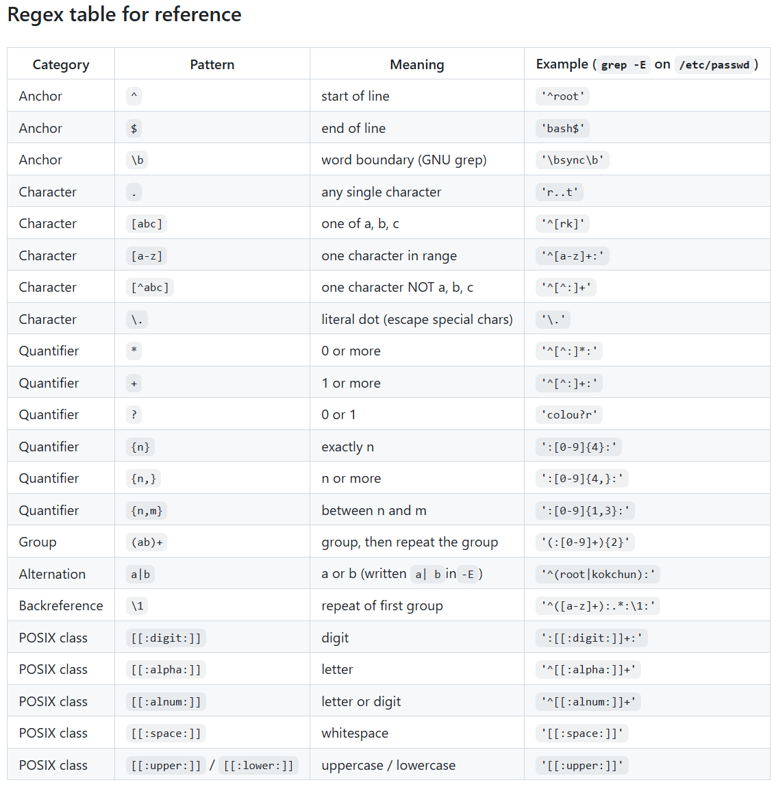

# Linux2_DBA26
Live coding in Linux 2 course


## Regex with grep -E
Regex or regular expression exists in many programming languages and many tools. A good point to start is grep with the E flag, which is the extended syntax for grep (some extra characters like + ? | () {} without backslashes).

Always use single quotes ['] for bash to ignore interpreting special characters.

```bash
# matches literal characters 'root'
grep -E 'root' /etc/passwd

# ^ anchor -> starting with root
grep -E '^root' /etc/passwd

# $ anchor -> end with bash
grep -E 'bash$' /etc/passwd

# characater class [], + is a quantifier giving one or more
grep -E '^[a-z]+' /etc/passwd

# matches one or several starting with k or o
grep -E '^[ko]+' /etc/passwd

# {n}: 4-digit UID
grep -E '[0-9]{4}' /etc/passwd

# accounts that can't login
# match ending with nologin or false - grouping and alternation (|)
grep -E '(nologin|false)$' /etc/passwd

# add c flag to grep to count it
grep -Ec '(nologin|false)$' /etc/passwd

# flip it with -v in grep -> all users that can login
grep -Ev '(nologin|false)$' /etc/passwd


# finds all users with /home. [^:]* means match any character not colon and * matches 0 or more of that character class
grep -E ':/home[^:]*' /etc/passwd

# to get the only matching and not the whole line use -o flag 
grep -Eo '/home/[^:]*' passwd
```


